<p align="center"></p>

<p align="center">
  <a href="LICENSE"></a>
  
  <a href="https://github.com/mrzroot/jenkins/commits"></a>
</p>

<p align="center"><a href="https://mrzroot.github.io/jenkins/">Website</a> · <a href="#فارسی">فارسی</a> · <a href="CHANGELOG.md">Changelog</a> · <a href="CONTRIBUTING.md">Contributing</a></p>

# Jenkins Pipeline Examples

Two tiny Jenkins pipelines for learning. Each one adds two numbers, halves the sum and prints the result, in three
stages. They show how a declarative `Jenkinsfile` is laid out, how one stage passes a value to the next through `env`,
and how to make Jenkins check the repository for new commits on its own.

## Files

| File | What it shows |
| --- | --- |
| [`Jenkinsfile`](Jenkinsfile) | Three stages (`Addition`, `Division`, `Final Result`) passing values through `env.SUM` and `env.R`. |
| [`jenkinsfile123`](jenkinsfile123) | The same pipeline plus `triggers { pollSCM '*/2 * * * *' }`, so Jenkins checks for new commits every 2 minutes. |

## Quick start

1. In Jenkins, create a **Pipeline** job.
2. Under **Pipeline**, choose **Pipeline script from SCM**, select Git and enter `https://github.com/mrzroot/jenkins.git`.
3. Set **Script Path** to `Jenkinsfile` (or `jenkinsfile123` for the polling version) and click **Build Now**.

Expected console output:

```text
The sum is: 8
The division result is: 4
The final result is: 4
```

## How it works

Values set on `env` inside a `script { }` block are visible in later stages, but only as strings, which is why the
`Division` stage calls `toInteger()` before dividing. `pollSCM` asks Jenkins to look at the repository on a cron
schedule and start a build only when something changed; a webhook is faster, but polling needs no setup on GitHub.

## فارسی

<div dir="rtl">

دو نمونه‌ی خیلی کوچک پایپ‌لاین Jenkins برای یادگیری. هر کدام دو عدد را جمع می‌کند، نصفش می‌کند و نتیجه را در سه مرحله چاپ می‌کند. فایل `Jenkinsfile` ساختار پایه را نشان می‌دهد و `jenkinsfile123` همان است، به‌اضافه‌ی اینکه Jenkins هر ۲ دقیقه خودش مخزن را برای تغییر تازه بررسی می‌کند.

</div>

## Contributing

Suggestions are welcome in [issues](../../issues/new/choose); see [CONTRIBUTING.md](CONTRIBUTING.md).

## License

MIT, see [LICENSE](LICENSE).
